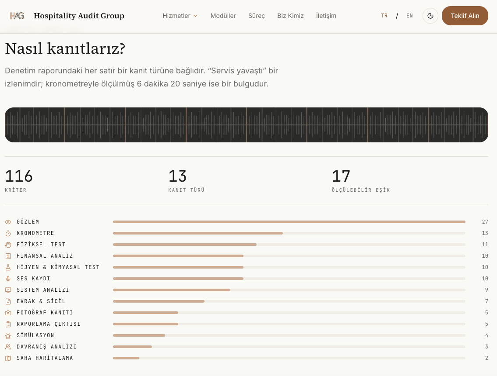
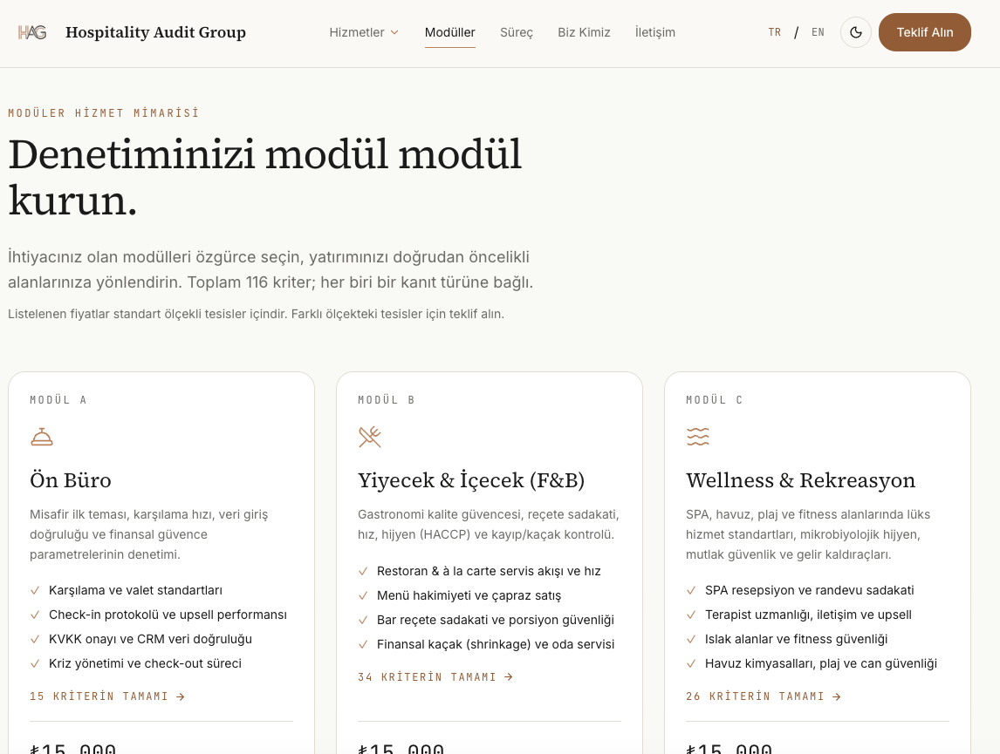
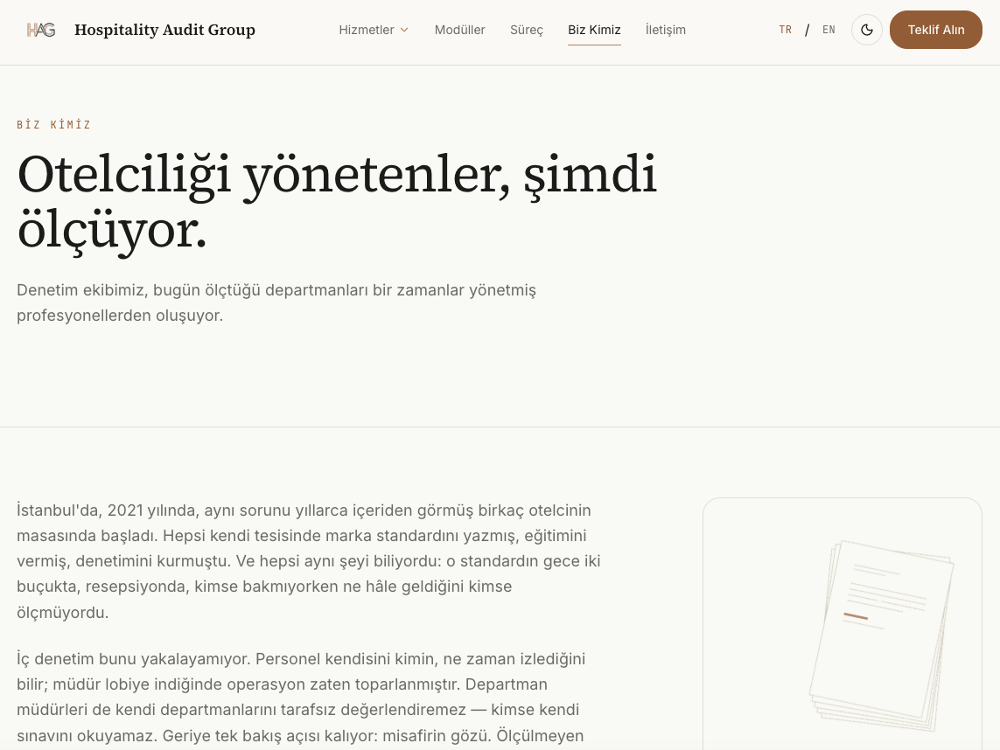
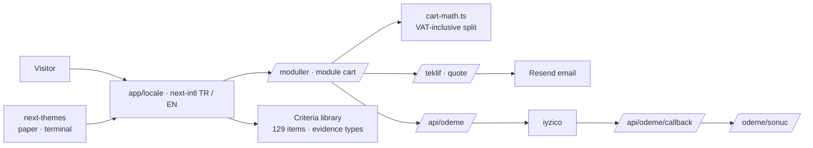

<div align="center">


<p>
  <a href="https://hospitalityauditgroup.vercel.app"></a>
  
  
  
</p>

<p><em>The corporate site of a company that audits hotels with mystery-guest visits and trains their staff.<br>
Built as a sales architecture: pick audit modules, see the price, check out or ask for a quote.</em></p>


</div>


## The idea

Audit firms usually hide behind "contact us for a proposal". This site does the opposite. Each audit module has a fixed price on the page, the criteria an auditor will score are published in full, and a hotel can buy a module directly or build a quote from several. Trust comes from showing the method, not from adjectives.

> **The method is the marketing.** All 129 criteria from the firm's field guides are on the site, grouped by module, each labelled with the kind of evidence the auditor collects. The wording from the guides is kept verbatim; a canonical category drives the icons and counts.


## What a visitor can do

| | |
|---|---|
| **Pick modules** | Front Office (A), Food & Beverage (B), Wellness & Recreation (C), Housekeeping & In-Room (E), each ₺15,000, or the 360° Full Audit (D) at ₺50,000. Staff training is ₺15,000. |
| **See the maths** | Prices are VAT-inclusive; the cart shows the net and the 20 % VAT split, computed in a small, tested module. |
| **Read the criteria** | Every module's checklist, grouped (for example *A.1 Greeting and valet standards*), with codes and evidence types. |
| **Check out** | Pay through iyzico with billing details, then land on a result page. |
| **Request a quote** | Send the cart as a quote request; the firm gets it by email through Resend. |
| **Learn the process** | Who they are, how a mystery-guest audit runs, and the two services in detail. |
| **Legal** | Privacy, KVKK, distance sales contract, pre-information form and cancellation / refund pages. |

| Module | Criteria |
|---|---|
| A · Front Office | 15 |
| B · Food & Beverage | 41 |
| C · Wellness & Recreation | 30 |
| D · 360° Full Audit | 21 |
| E · Housekeeping & In-Room | 22 |


## Design: paper and terminal

Two themes, two faces of the same site:

- **Light, the report paper**: cream background, serif headings, generous white space. The audit report in your hands.
- **Dark, the operations terminal**: anthracite background and mono log lines. The auditor's screen in the field.

The visual courage is spent in one place: the **audit terminal** in the hero, which types out an audit line by line.

<table>
  <tr>
    <td width="33%"></td>
    <td width="33%"></td>
    <td width="33%"></td>
  </tr>
</table>


## Under the hood



| Route | Page |
|---|---|
| `/` | Home with the audit terminal |
| `/moduller` · `/moduller/[slug]` | Modules and their criteria |
| `/hizmetler/gizli-musteri-denetimi` · `/hizmetler/personel-egitimi` | The two services |
| `/biz-kimiz` · `/surec` · `/iletisim` | About, process, contact |
| `/teklif` · `/odeme/sonuc` | Quote and payment result |
| `/gizlilik-politikasi` · `/kvkk` · `/mesafeli-satis-sozlesmesi` · `/on-bilgilendirme` · `/iptal-iade` | Legal |


## Türkçe özet

**Hospitality Audit Group**, otelleri gizli müşteri ziyaretleriyle denetleyen ve personel eğitimi veren bir firmanın kurumsal sitesi. Broşür değil, satış mimarisi: ziyaretçi denetim modüllerini (ön büro, yiyecek-içecek, wellness, kat hizmetleri; her biri ₺15.000, 360° tam denetim ₺50.000) sepete ekliyor, KDV dahil fiyatı ve net/KDV ayrımını görüyor, iyzico ile ödüyor ya da teklif istiyor. Denetçinin puanlayacağı 129 kriterin tamamı sitede açık. Açık temada rapor kâğıdı, koyu temada operasyon terminali; Türkçe ve İngilizce.


## Development

```sh
npm install
npm run dev            # http://localhost:3000
npm test               # vitest: cart maths, billing schema, criteria translation
npm run typecheck
npm run check-links    # crawls every route in every locale against a running server
npm run build
```

`.env.local` takes `RESEND_API_KEY`, `MAIL_FROM` and `CONTACT_EMAIL` for quotes, and `IYZICO_API_KEY`, `IYZICO_SECRET_KEY` and `IYZICO_BASE_URL` for checkout.

```
app/[locale]/       pages (Turkish routes) and app/api/ (teklif, odeme, callback)
components/         home, modules, criteria, services, forms, legal, layout, ui
lib/                modules data, criteria (A–E), cart maths, quote and billing schemas, payment
messages/           tr.json · en.json
scripts/            check-links.mjs
```

<div align="center">
<br>
<a href="https://github.com/kutluhangil"></a>
<sub>Client project · brand assurance and operational leverage · the hotel in the banner is unnamed.</sub>
</div>
