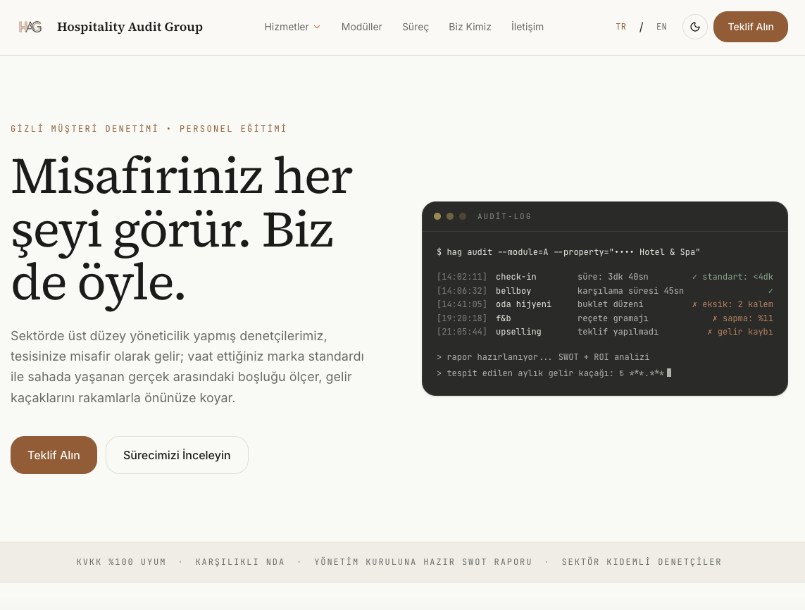
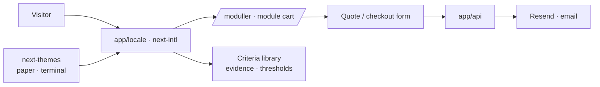

<div align="center">



<p>
  <a href="https://hospitalityauditgroup.vercel.app"></a>
  
  
  
</p>

<p><em>The corporate site of a company that audits hotels with mystery-guest visits and trains their staff.<br>
Not a brochure but a sales architecture: choose audit modules, see the price, pay or ask for a quote.</em></p>



</div>


## The idea

A hotel owner arrives, picks which areas of the property to audit module by module, adds them to a cart and sees the price. The commercial heart is `/moduller`; the persuasive heart is the audit criteria themselves: what is measured, with which evidence and at which threshold. Competitors hide their methodology; this site shows it.

**What it deliberately leaves out:** stock hotel photos, a wall of client logos, auditor faces, unverifiable testimonials and hidden prices. A company that sells discretion cannot expose its clients, so it shows evidence instead of praise.


## Design: paper and terminal

Two themes, two faces of the same site:

- **Light, the report paper**: cream background, serif headings, generous white space. The audit report in your hands.
- **Dark, the operations terminal**: anthracite background and mono log lines. The auditor's screen in the field.

The visual courage is spent in one place: the **audit terminal** in the hero, which types out an audit line by line.

<table>
  <tr>
    <td width="33%"></td>
    <td width="33%"></td>
    <td width="33%"></td>
  </tr>
</table>


## Under the hood




## Türkçe özet

**Hospitality Audit Group**, otellere gizli müşteri denetimi ve personel eğitimi sunan bir firmanın kurumsal web sitesi. Bir tanıtım sitesinden çok satış mimarisi: otel sahibi denetlenecek alanları modül modül seçip sepete ekliyor, fiyatı görüyor, ödüyor ya da teklif istiyor. Denetim kriterleri (neyin, hangi kanıtla, hangi eşikte ölçüldüğü) açıkça gösteriliyor. Açık temada rapor kâğıdı, koyu temada saha terminali görünümü var; Türkçe ve İngilizce.


## Development

```sh
npm install
cp .env.example .env.local     # Resend key and contact address
npm run dev                    # http://localhost:3000
npm test                       # vitest
npm run typecheck
npm run check-links
npm run build
```

<div align="center">
<br>
<a href="https://github.com/kutluhangil"></a>
<sub>Evidence, not praise.</sub>
</div>
